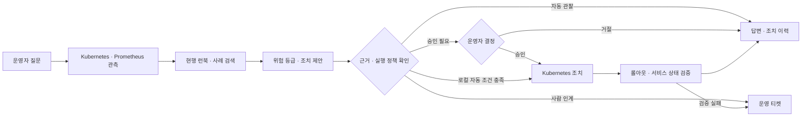

# DataCenterUsedAws

데이터 센터 Kubernetes 통합 운영 지원 AI Agent with AWS

운영자가 서비스 상태, 응답 지연, 장애 원인, 증설 필요성을 자연어로 물으면 Kubernetes와 Prometheus에서 관측값을 모읍니다. 에이전트는 관측 근거와 운영 절차서(런북)를 인용해 원인과 대응을 제시합니다. 허용된 조치를 실행한 뒤에는 롤아웃, Pod 준비 상태, 오류율과 응답 시간을 다시 확인합니다.

## 주요 기능

| 화면 | 할 수 있는 일 |
| --- | --- |
| **Copilot** | 자연어로 운영 상태를 질문하고, 위험 등급·원인·근거·권장 조치를 확인합니다. 승인 대기 중인 제안은 해당 화면에서 승인하거나 거절합니다. |
| **상황 생성기** | EKS에서 기존 워크로드 실습 14종과 운영 기록 재생 4종을 선택·무작위·18종 묶음으로 실행합니다. kind에서는 기존 14종을 사용합니다. 등급 비율을 지정한 100회 평가도 구성할 수 있습니다. |
| **혼동행렬** | 에이전트의 탐지 결과를 독립 HTTP 측정으로 얻은 정답과 비교합니다. 사례별 모델 판단, 실제 조치, 복구와 정리 결과를 열어 볼 수 있습니다. |
| **클러스터 현황** | Deployment·Pod·Service와 요청량, 5xx 비율, p95 응답 시간, CPU·메모리를 조회합니다. Grafana가 연결되면 실험 시간대의 지표를 열 수 있습니다. |
| **조치** | 데모 앱에서 요청을 시험하고, 운영 티켓을 접수하거나 처리 결과를 남깁니다. 데모 앱은 일시적인 요청 실패를 한 번 재시도한 뒤 응답 본문을 확인합니다. |

## 진단과 조치 흐름



LangGraph가 질문 해석, 관측, 검색, 판단, 승인 및 실행을 연결합니다. 검색 증강 생성(RAG)은 [EKS 운영 런북 v3.0](knowledge/runbooks/v3/)와 [예시 장애 사례](knowledge/incidents/)를 검색 결과로 제공합니다. 관측이 부족하거나 판단의 확신도가 낮으면 한 번 더 측정한 뒤 판단을 보류하거나 사람에게 인계합니다.

- **실행 범위**는 `demo/api`와 `demo/web`의 재시작·롤백·복제본 조정입니다. 복제본은 1~6개로 제한합니다. 실행 직전에 대상 배포의 버전과 조치 조건을 다시 확인합니다.
- **제한 자동 조치**는 전용 로컬 kind의 `demo/api`에서만 켤 수 있습니다. 런북과 관측 조건을 충족한 경우 복제본을 한 개 늘리거나, 이전 리비전이 정상 서비스 중인 상태에서 실패한 리비전을 롤백합니다. 자동 조치 옵션의 기본값은 꺼짐입니다.
- **운영자 승인과 사람 인계**는 판단 근거와 위험에 따라 결정합니다. 비용 검토가 필요한 증설, 권한 범위 밖 변경, 계속된 판단 보류, 복구 검증 실패는 운영 티켓으로 확인할 수 있습니다.
- **권한과 데이터**는 [ServiceAccount 설정](k8s/rbac/agent-rbac.yaml)에서 제한합니다. 에이전트는 `demo` 상태와 실습 여부를 확인하는 노드 한 대를 조회하고, 지정된 Deployment 두 개만 변경할 수 있습니다. 질문, 선별된 운영 로그, 런북 등이 모델 제공자로 전송되므로 실습 데이터를 사용하세요.

## 로컬 실행

Docker가 실행 중이어야 합니다. 클러스터 구성에는 `kind`, `kubectl`, `helm`을 사용하고 Python 의존성은 `uv`로 설치합니다. 아래 명령은 GitHub Actions와 같은 Python 3.11을 사용합니다.

```bash
uv sync --locked --python 3.11
./scripts/setup-cluster.sh
cp -n .env.example .env
```

설치 스크립트는 control-plane 1대와 worker 2대로 전용 kind 클러스터 `datacenterusedaws`를 만듭니다. 데모 앱, 부하 생성기, Prometheus와 에이전트 권한을 구성합니다. 데모 웹과 Prometheus는 각각 로컬 8080번, 9090번 포트를 사용합니다. 기존 실습이 해당 포트를 사용 중이라면 포트가 비어 있을 때 새 클러스터를 시작하세요.

### 모델 연결

[환경 변수 예시](.env.example)를 참고해 `.env`를 설정합니다.

| 설정 | 용도 |
| --- | --- |
| `OPENAI_API_KEY` | 값을 지정하면 채팅과 문서 임베딩에 OpenAI를 사용합니다. 모델 이름은 `OPENAI_CHAT_MODEL`, `OPENAI_EMBEDDING_MODEL`로 지정할 수 있습니다. |
| `AZURE_OPENAI_ENDPOINT`와 배포 이름 | `OPENAI_API_KEY`를 비워 두면 Azure OpenAI를 사용합니다. 채팅·임베딩 배포 이름과 API 버전을 입력하고 Azure API 키 또는 권한이 있는 Azure 계정으로 인증합니다. |
| `KUBEOPS_KUBECONFIG`, `PROMETHEUS_URL` | 기본값은 `.kube/agent.kubeconfig`와 `http://127.0.0.1:9090`입니다. 기존 실습을 연결할 때는 제한된 에이전트 접근 설정과 그 클러스터의 Prometheus 주소를 지정합니다. |
| `KUBEOPS_LOCAL_LAB` | 기본값은 `0`입니다. 새로 구성한 전용 kind에 연결한 경우에만 `1`로 설정해 UI에서 실제 장애를 재현하고 제한 자동 조치를 평가할 수 있습니다. |

OpenAI 설정을 사용한다면 `.env.example`의 Azure 주소 예시는 비워 두세요. 모델 설정을 바꾼 뒤 웹을 재시작합니다. 모델 호출에는 제공자별 사용료가 발생할 수 있습니다.

### 웹과 CLI

```bash
KUBEOPS_WEB_TARGET=kind uv run --no-sync --python 3.11 streamlit run app/streamlit_app.py
```

브라우저에서 [http://127.0.0.1:8501](http://127.0.0.1:8501)을 엽니다. 승인자 이름은 이력에 기록되는 값입니다. 웹은 기본적으로 로컬 주소에서 열리며, 외부에 포트를 노출하지 마세요.

```bash
uv run --no-sync --python 3.11 kubeops check
uv run --no-sync --python 3.11 kubeops ask "demo/api가 느려진 원인을 확인해 줘"
uv run --no-sync --python 3.11 kubeops cases
```

설치·장애 재현 스크립트는 `.kube/admin.kubeconfig`를 사용합니다. 웹과 CLI는 별도 에이전트 자격을 사용합니다. 스크립트는 에이전트 토큰의 유효 기간을 8시간으로 요청합니다. 만료되면 `./scripts/make-agent-kubeconfig.sh`를 실행한 뒤 웹을 다시 시작합니다.

## 관측과 수동 배포

전용 kind가 실행 중일 때 `./scripts/setup-observability.sh`로 Grafana와 Argo CD를 설치할 수 있습니다. Grafana는 Prometheus 지표를 표시합니다. Argo CD는 공개 저장소의 `main`에서 데모 Deployment와 Service 정의를 읽습니다. 커밋과 Diff를 확인한 운영자가 **Sync**를 눌러 변경을 적용합니다. [설치 후 접속과 포트 포워딩](docs/demo-script.md#장애-전후-대시보드와-배포-비교)

## 평가와 테스트

실행 계획은 클러스터나 모델 호출 없이 확인할 수 있습니다.

```bash
uv run --no-sync --python 3.11 python eval/single_detection.py --case batch --seed 42 --plan
```

전용 kind를 구성한 뒤 `--fixtures-only`로 실제 장애를 재현하고 관측·복구를 확인할 수 있습니다. 모델을 포함한 평가에서는 독립 HTTP 정답과 에이전트 판정을 비교하고, 판단 보류·시간 초과도 기록합니다. 결과는 `eval/results/`에 로컬 저장됩니다. [시나리오와 채점 기준](docs/demo-script.md#단일-14종-평가와-혼동행렬)

`main` 푸시와 PR에서 GitHub Actions가 고정된 의존성으로 단위 테스트를 실행합니다. 같은 테스트는 모델 자격 증명이나 실행 중인 클러스터 없이 실행할 수 있습니다.

```bash
uv run --no-sync --python 3.11 python -m unittest discover -s tests -v
```

## 코드 안내

| 경로 | 역할 |
| --- | --- |
| [`app/`](app/) | Streamlit 웹 화면 |
| [`kubeops_copilot/`](kubeops_copilot/) | 진단 흐름, Kubernetes·Prometheus 조회, 모델·런북 검색, 승인 및 실행 |
| [`k8s/`](k8s/) · [`scripts/`](scripts/) | kind·EKS 클러스터, 데모 앱, 관측 도구와 권한 구성 |
| [`knowledge/`](knowledge/) | 현행 런북과 예시 장애 사례. 검토용 조치 사례는 `knowledge/candidates/`에 로컬 저장 |
| [`scenarios/`](scenarios/) · [`eval/`](eval/) | 장애 재현, 탐지·복구 평가, 조치 요청 차단 점검 |
| [`tests/`](tests/) | 분류·가드·승인·복구와 UI 단위 테스트 |

운영 이력과 티켓은 로컬 SQLite 파일 `data/kubeops.db`에 남습니다. 승인 대기 중인 제안은 웹 프로세스를 다시 시작하면 사라집니다. 전용 kind 실습을 종료할 때는 웹을 멈춘 뒤 `./scripts/teardown.sh`로 해당 클러스터를 삭제할 수 있습니다.

## AWS EKS와 EC2 실습

서울 리전의 전용 EKS 클러스터와 `scenario-workers` 관리형 노드 그룹을 사용합니다. 워커는 t3.medium 두 대이며 EKS, EC2, EBS와 공인 IPv4 비용이 발생합니다. AWS CLI, eksctl, Helm, kubectl과 위에서 설치한 Python 가상환경이 필요합니다. AWS CLI 인증 후 `AWS_PROFILE`과 `KUBEOPS_AWS_ACCOUNT`를 대상 프로필 및 예상 계정 ID로 설정하세요.

```bash
./scripts/eks-lab.sh create
./scripts/eks-lab.sh setup
./scripts/eks-lab.sh run first-three
```

첫 세 실험은 정상 운영, readiness 검사 실패, 워커 점검 순서로 실행됩니다. 각 결과의 `injected`, `probes`, `after_fixture_cleanup`에서 장애 신호, 독립 HTTP 측정, 복구 상태를 확인합니다. `run all`은 기존 실습 14종과 재생 4종을 순차 실행하며 CLI 기본 실행은 모델 호출을 생략합니다. 진단까지 평가하려면 AWS 웹의 상황 생성기에서 진단을 선택하세요. 기존 워크로드 실습 CLI와 웹은 같은 터널 포트를 사용합니다. 재생 4종만 실행할 때는 터널이 필요 없어 웹을 켜 둬도 됩니다.

### 8501번 웹을 AWS에 연결하기

클러스터를 생성하고 `setup`을 완료한 뒤 아래 명령으로 웹을 시작합니다. 이미 실행 중인 클러스터에는 `create`를 다시 실행할 필요가 없습니다.

```bash
./scripts/eks-lab.sh web
```

[로컬 웹](http://127.0.0.1:8501/)의 **EKS · EC2 현황 → 현황**에서 관리형 노드 그룹의 실제 EC2 인스턴스 ID·상태·유형·가용 영역을 확인할 수 있습니다. Pod 표의 노드 이름과 EC2 표의 노드 DNS로 어느 워커가 Pod를 실행하는지 확인합니다. 같은 화면의 Deployment, Pod, Service는 EKS API에서 조회합니다. **상세 모니터링**은 EKS 안의 Grafana와 Prometheus를 사용합니다.

| 맥에서 여는 포트 | 연결 대상 |
| --- | --- |
| 8501 | Streamlit 운영 화면 |
| 18080 | EKS의 데모 웹 |
| 19090 | EKS의 Prometheus |
| 13000 | EKS의 Grafana |

혼동행렬에는 EKS에서 저장한 실측만 표시합니다. 이전 클러스터의 기록은 계속 열람할 수 있습니다. 티켓과 조치 이력은 이 프로젝트의 `data/eks-kubeops.db`에 저장합니다. AWS 연결 설정 없이 Streamlit만 시작하면 저장된 EKS 실측 화면이 열립니다. 모델 진단을 사용할 때는 현재 프로젝트의 환경 변수 또는 `.env`에 모델을 설정하세요.

맥의 AWS CLI 세션이 유효한 동안 웹은 에이전트의 제한된 ServiceAccount 토큰을 갱신합니다. AWS CLI 세션이 만료되면 해당 프로필로 다시 로그인하세요. 웹을 종료해도 AWS 클러스터와 워커는 계속 실행되고 이용료가 발생합니다.

실험 실행기는 운영자 자격으로 실험 리소스를 관리하고 에이전트는 기한이 있는 별도 ServiceAccount 토큰을 사용합니다. EKS에서는 증설을 비용 검토 대상으로 취급합니다. 실습을 끝내면 `./scripts/eks-lab.sh delete`로 이 실습의 클러스터와 관리형 노드 그룹을 삭제하세요.

### 앱 HTTP와 Kubernetes 작업을 따로 확인하기

EKS 설치 시 `traffic/http-observer` Pod 하나가 기존 워커에서 실행됩니다. 기존 클러스터에는 `./scripts/eks-lab.sh observer`로 설치하거나 갱신할 수 있습니다. 관측 Pod는 ServiceAccount 토큰을 마운트하지 않습니다. `demo/api`의 Service DNS로 보내는 HTTP 요청 4건의 상태 코드와 지연을 한 묶음으로 기록합니다. 상태 확인용 보조 요청 1건과 `demo/web`의 echo 확인도 별도로 보냅니다. 새 평가(`shared-http-v1`)에서는 채점기와 에이전트가 동일한 4건 묶음의 시각·응답 코드·지연·실패 수·p95를 사용합니다. 별도 보조 요청은 탐지 채점용 묶음을 대체하지 않습니다. 묶음 사이에는 2초를 쉬며, 이 트래픽도 앱의 실제 요청량에 포함됩니다.

평가기는 구간과 클러스터 생성 시각을 기록하고 관측 로그를 회수합니다. 모델에는 관측값과 일반 판정 기준·런북만 전달하며 사건별 정답 등급·처리 방식·목표 등급·시드는 전달하지 않습니다. 최초 구간 이후 재측정은 `recheck_probes`에 따로 저장하고 최초 구간의 HTTP 정답을 바꾸지 않습니다. 재생 4종도 채점 시작 시점 이후의 동일 묶음을 공유합니다. **혼동행렬 → 실험 상세 → 독립 관측**에서 앱 HTTP 점수, Kubernetes 조회·변경 요청 결과, Deployment 세대와 새 Pod의 노드 할당을 따로 확인합니다. 시간 초과된 변경의 저장 여부와 회수하지 못한 HTTP 표본은 미확정으로 남습니다. 배치 결과는 관측한 스냅샷을 기준으로 합니다. 수동 데모 요청은 기존 터널을 사용하며, 독립 관측으로 확인되지 않은 터널 실패는 앱 장애로 채점하지 않습니다.

사건 JSON과 HTTP JSONL을 내려받아 **혼동행렬 → 독립 관측 파일 재생**에 올리면 클러스터 연결이나 모델 호출 없이 같은 구간을 재생합니다. API가 복구된 뒤에는 아래 명령으로 컨테이너에 남아 있는 HTTP 로그를 회수할 수도 있습니다. Pod 교체나 컨테이너 로그 회전으로 유실된 자료는 복구할 수 없습니다. 예전 평가 보고서는 기존 측정 방식으로 표시됩니다. 기존 100회 JSON과 판정은 수정하지 않습니다. 혼동행렬의 관측 버전 선택에서 `기존 별도 HTTP 관측`과 `동일 HTTP 관측`을 나눠 조회합니다. 서로 다른 관측 버전의 평가를 같은 보고서로 이어 실행하지 않습니다.

```bash
kubectl --kubeconfig .kube/eks-admin.kubeconfig --context datacenterusedaws-lab \
  -n traffic logs deploy/http-observer -c observer --since=30m > .kube/http.jsonl
.venv/bin/python -m kubeops_copilot.observations incident.json .kube/http.jsonl
```

### EKS 18종 생성기와 채점

로그 제너레이터에서 한 유형, 무작위 단일, 18종 묶음 또는 100회 평가를 선택합니다. 기존 14종의 시드별 조건과 상대 순서는 보존합니다. EKS 100회 평가는 18종을 최소 한 번씩 배정합니다. 기본 목표는 정상 35회, 주의 45회, 장애 15회, 중대 장애 5회입니다. 재생 4종은 주의 목표에 배정하고 결과 등급은 실제 HTTP와 운영 기록으로 결정합니다. 단일·묶음·100회 평가에서 진단을 켜면 앱이 먼저 회복한 사건도 모델에 전달해 장애 여부·위험 등급·처리 방식을 평가합니다. 사람이 승인하거나 복구할 때까지 기다리지 않으며, 평가기가 다음 회차를 위해 실험 환경을 복원합니다. 혼동행렬 탭에서 실행 기록을 선택하면 시나리오별 계획·실측·판정 건수를 확인할 수 있습니다. 중단한 EKS 평가는 같은 탭의 이어서 실행 버튼으로 재개합니다. 완료된 회차는 보존하고 마지막 실측 실패는 같은 회차로 다시 시도합니다. 시드가 같으면 합성 기록의 상대 시각·내용이 같습니다. 정확히 같은 HTTP까지 재생하려면 최초 실행의 두 파일을 사용하세요.

```bash
# 기존 실습 계정의 AWS_PROFILE과 KUBEOPS_AWS_ACCOUNT를 설정한 상태에서 실행
./scripts/eks-lab.sh run replays 42
./scripts/eks-lab.sh run scheduler-stall 16
```

재생기는 워커에 남은 최근 HTTP와 현재 Ready 엔드포인트 수를 읽고, 같은 구간에 시드 기반 API 조회·변경·Pod 기록을 배치합니다. 원본과 합성 기록에는 각각 출처가 표시됩니다. 기준 시점 이후의 앱 영향은 사건 단위로, 권장 처리는 마지막 운영 확인 이후의 HTTP까지 보고 채점합니다. 진단을 선택하면 같은 프로젝트의 에이전트에 관측 근거만 제공하며, 재생 판단으로 실제 클러스터를 변경하지 않습니다.

| 재생 시나리오 | 시드로 바뀌는 증거 | 운영 판단 |
| --- | --- | --- |
| API 응답 실패 | PC·VPC 중 한 지점 또는 양쪽의 조회 시간 초과 | 한 지점만 지속되면 해당 경로, 양쪽이면 클러스터 운영자에게 인계. 쓰기는 미확인 |
| 스케줄러 배치 중단 | 새 Pod 1~3개, 노드 미할당, 리더 갱신 기록 공개 여부 | 배치 가능 워커와 Pod 상태를 확인. 리더 근거가 없으면 원인 미확정 |
| 컨트롤러 반영 지연 | 목표 2→3 또는 3→5 저장 후 새 Pod 미생성 | 생성 지연과 이미 생성된 Pod의 배치 지연을 구별 |
| etcd 저장 공간 한도 | ConfigMap 생성 또는 Deployment 변경 실패, 확인당 1~3회 시도, NOSPACE 제공 여부 | 조회 성공과 쓰기 실패를 기록. 알람이 있을 때 공간 한도로 좁힘 |

네 유형 모두 발생 시점 5·10초, 지속 시간 15·45·90초, 회복·지속 결말을 바꿉니다. 마지막 운영 확인 뒤 8초의 HTTP 구간을 포함합니다.

| 위험 등급 | 재생 채점 기준 |
| --- | --- |
| 정상 | 대조 구간에서 앱 실측이 정상이고 운영 이상도 없음. 이상이 있었던 사건은 회복돼도 사건의 최고 등급을 보존 |
| 주의 | 앱 실패율과 지연이 기준 이내이나 조회·쓰기·생성·배치 이상이 관측됨 |
| 장애 | 실측 요청 묶음의 실패율이 5% 초과 또는 p95가 300ms 초과. 측정 구간 말기에 Ready 엔드포인트 0개가 확인되고 HTTP 근거가 있는 경우도 포함 |
| 중대 장애 | Ready 엔드포인트 0개를 실측했고, 그 조회 직전 20초 안의 연속 두 HTTP 묶음이 모두 실패 |
| 판단 보류 | 장애 이후 HTTP가 없거나, 정상을 판정할 최신 표본이 부족함 |

| 권장 처리 방식 | 적용 기준 |
| --- | --- |
| 자동 관찰 | 두 조회 경로 복구, 새 Pod 할당·Ready, 목표 수만큼 Pod 생성·Ready, 또는 쓰기 성공과 값 확인. 마지막 확인 이후 앱 요청도 정상 |
| 제한 자동 조치 | 기존 제한된 런북의 자동 변경 경로. EKS 운영 기록 재생에서는 선택 근거가 없음 |
| 운영자 승인 후 에이전트 실행 | 실제 워크로드의 변경 대상·런북·승인이 확인된 경우. 새 4종에는 해당하는 변경 절차가 없음 |
| 사람이 직접 처리 | 문제가 계속되거나 최종 회복 증거 부족, 앱 실패 지속, 엔드포인트 0개. 확인한 작업 단계와 미확정 원인을 함께 전달 |

### 기존 14종의 AWS 실행과 랜덤 조건

기존 14종의 장애 원리는 동일합니다. EKS에서는 실험 전용 네임스페이스의 리소스와 관리형 EC2 워커가 대상입니다. 공통 시드 조건은 배경 요청 15·20·25 req/s, 정상 배포 배경 여부, 시작 복제본 수, 발생·관측 시점과 모델에 제공할 로그·지표 범위입니다. 아래의 ‘새 버전/전체’는 기존 Pod를 유지하는 순차 배포와 기존 Pod를 교체하는 재생성 배포를 뜻합니다.

| 유형 | AWS에서 실행·관측하는 내용 | 유형별 시드 변형 |
| --- | --- | --- |
| 정상 운영 | EKS demo/api의 기준 트래픽과 워커 HTTP 응답 확인 | 배경 요청·복제본·관측 시간 |
| 일시적 타임아웃 | EKS에 경고 이벤트 생성. 평가용 echo 경로에서 첫 요청 503과 재시도 관측 | 경고 500·750·1000ms, 1·3회 반복 |
| 배포 후 응답 지연 | demo/api에 지연을 넣은 버전 배포, 워커에서 실제 지연 측정 | 300~700ms 또는 550~850ms |
| Service 연결 단절 | api Service의 selector를 바꾸고 연결할 Pod와 HTTP 확인 | 공통 배경·시점·지속 시간 |
| Pod 반복 재시작 | 잘못된 실행 인자로 배포하고 재시작·컨테이너 상태 확인 | 새 버전/전체 |
| 컨테이너 메모리 부족 | 128Mi 제한 컨테이너에 256MB 메모리 요청 후 OOMKilled 확인 | 새 버전/전체 |
| Readiness 실패 | 잘못된 준비 검사 경로를 적용하고 Ready·기존 트래픽 관측 | 새 버전/전체 |
| 트래픽 급증 | EKS의 임시 Fortio Pod에서 요청을 발생시키고 지연·포화 관측 | 추가 600·1000·2000 req/s, 짧은 급증·계단형·지속형, 1·3회 |
| CPU 부족 배치 실패 | EC2 워커에 수용할 수 없는 CPU 요청으로 FailedScheduling 확인 | 256·512·999코어, 새 버전/전체 |
| 이미지 다운로드 실패 | 존재하지 않는 태그로 배포하고 이미지 가져오기 실패 관측 | 새 버전/전체. 태그 식별자는 실행마다 생성 |
| DNS 조회 실패 | 시험 클라이언트의 잘못된 이름과 정상 Service IP 호출 비교 | 잘못된 이름/네임스페이스, 클라이언트 1·2개 |
| 워커 점검 | 전용 EC2 워커를 cordon하고 API Pod 하나를 Eviction한 뒤 다른 노드 배치와 복구 확인 | Ready Pod 후보 인덱스, 시작 복제본 2·3개 |
| 요청 지표 누락 | API Pod의 Prometheus 수집을 끄고 워커 HTTP와 비교 | 공통 배경·시점·증거 공개 범위 |
| 볼륨 할당 대기 | 없는 StorageClass를 요청해 PVC와 Pod Pending 확인 | 1·8·16Mi, 새 버전/전체 |

### EKS에서 확인한 결과

2026년 11월 22일 서울 리전의 EC2 워커 두 대에서 시드 42로 측정했습니다. 요청 수는 클러스터 내부의 독립 HTTP 측정기가 보낸 요청만 집계한 값입니다.

| 시나리오 | 관측한 동작 | 성공한 요청 |
| --- | --- | --- |
| 정상 운영 | API가 HTTP 200으로 응답했습니다. | 36/36 |
| Readiness 실패 | 새 Pod에서 검사 경로가 404를 반환했습니다. 기존 Ready Pod 두 개가 계속 요청을 처리했습니다. | 8/8 |
| 워커 점검 | 워커 한 대의 신규 배치를 막고 API Pod 하나를 퇴거시켰습니다. 대체 Pod가 다른 EC2 워커에서 Ready가 됐습니다. | 36/36 |

초기 검증 후 API와 웹은 각각 2/2 Ready였고 두 워커 모두 새 Pod를 받을 수 있었습니다. 이어 진행한 18종 100회 평가의 탐지·위험 등급·처리 방식 혼동행렬과 회차별 판정은 [EKS 100회 평가 결과](docs/evaluations/eks-100-2026-11-22.md)에서 확인할 수 있습니다.
