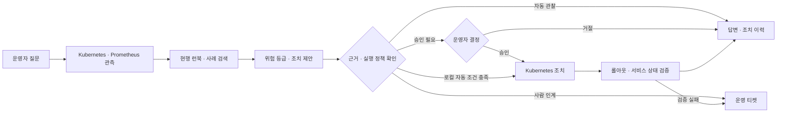

# DataCenterUsedAws

데이터 센터 Kubernetes 통합 운영 지원 AI Agent

운영자가 서비스 상태, 응답 지연, 장애 원인, 증설 필요성을 자연어로 물으면 Kubernetes와 Prometheus에서 관측값을 모읍니다. 에이전트는 관측 근거와 운영 절차서(런북)를 인용해 원인과 대응을 제시합니다. 허용된 조치를 실행한 뒤에는 롤아웃, Pod 준비 상태, 오류율과 응답 시간을 다시 확인합니다.

## 주요 기능

| 화면 | 할 수 있는 일 |
| --- | --- |
| **Copilot** | 자연어로 운영 상태를 질문하고, 위험 등급·원인·근거·권장 조치를 확인합니다. 승인 대기 중인 제안은 해당 화면에서 승인하거나 거절합니다. |
| **상황 생성기** | 정상 운영, 트래픽 급증, 반복 재시작, DNS 조회 실패 등 14가지 상황의 조건과 합성 로그를 시드로 재현합니다. 전용 kind에서 단일 상황, 14종 묶음 또는 등급 비율을 지정한 100회 평가를 실행할 수 있습니다. |
| **혼동행렬** | 에이전트의 탐지 결과를 독립 HTTP 측정으로 얻은 정답과 비교합니다. 사례별 모델 판단, 실제 조치, 복구와 정리 결과를 열어 볼 수 있습니다. |
| **클러스터 현황** | Deployment·Pod·Service와 요청량, 5xx 비율, p95 응답 시간, CPU·메모리를 조회합니다. Grafana가 연결되면 실험 시간대의 지표를 열 수 있습니다. |
| **조치** | 데모 앱에서 요청을 시험하고, 운영 티켓을 접수하거나 처리 결과를 남깁니다. 데모 앱은 일시적인 요청 실패를 한 번 재시도한 뒤 응답 본문을 확인합니다. |

## 진단과 조치 흐름



LangGraph가 질문 해석, 관측, 검색, 판단, 승인 및 실행을 연결합니다. 검색 증강 생성(RAG)은 [현행 런북 v2](knowledge/runbooks/v2/)와 [예시 장애 사례](knowledge/incidents/)를 검색 결과로 제공합니다. 관측이 부족하거나 판단의 확신도가 낮으면 한 번 더 측정한 뒤 판단을 보류하거나 사람에게 인계합니다.

- **실행 범위**는 `demo/api`와 `demo/web`의 재시작·롤백·복제본 조정입니다. 복제본은 1~6개로 제한합니다. 실행 직전에 대상 배포의 버전과 조치 조건을 다시 확인합니다.
- **제한 자동 조치**는 전용 로컬 kind의 `demo/api`에서만 켤 수 있습니다. 런북과 관측 조건을 충족한 경우 복제본을 한 개 늘리거나, 이전 리비전이 정상 서비스 중인 상태에서 실패한 리비전을 롤백합니다. 자동 조치 옵션의 기본값은 꺼짐입니다.
- **운영자 승인과 사람 인계**는 판단 근거와 위험에 따라 결정합니다. 비용 검토가 필요한 증설, 권한 범위 밖 변경, 계속된 판단 보류, 복구 검증 실패는 운영 티켓으로 확인할 수 있습니다.
- **권한과 데이터**는 [ServiceAccount 설정](k8s/rbac/agent-rbac.yaml)에서 제한합니다. 에이전트는 `demo` 상태와 실습 여부를 확인하는 노드 한 대를 조회하고, 지정된 Deployment 두 개만 변경할 수 있습니다. 질문, 선별된 운영 로그, 런북 등이 모델 제공자로 전송되므로 실습 데이터를 사용하세요.

## 로컬 실행

Docker가 실행 중이어야 합니다. 클러스터 구성에는 `kind`, `kubectl`, `helm`을 사용하고 Python 의존성은 `uv`로 설치합니다. 아래 명령은 GitHub Actions와 같은 Python 3.11을 사용합니다.

```bash
uv sync --locked --python 3.11
./scripts/setup-cluster.sh
cp -n .env.example .env
```

설치 스크립트는 control-plane 1대와 worker 2대로 전용 kind 클러스터 `datacenterusedaws`를 만듭니다. 데모 앱, 부하 생성기, Prometheus와 에이전트 권한을 구성합니다. 데모 웹과 Prometheus는 각각 로컬 8080번, 9090번 포트를 사용합니다. 기존 실습이 해당 포트를 사용 중이라면 포트가 비어 있을 때 새 클러스터를 시작하세요.

### 모델 연결

[환경 변수 예시](.env.example)를 참고해 `.env`를 설정합니다.

| 설정 | 용도 |
| --- | --- |
| `OPENAI_API_KEY` | 값을 지정하면 채팅과 문서 임베딩에 OpenAI를 사용합니다. 모델 이름은 `OPENAI_CHAT_MODEL`, `OPENAI_EMBEDDING_MODEL`로 지정할 수 있습니다. |
| `AZURE_OPENAI_ENDPOINT`와 배포 이름 | `OPENAI_API_KEY`를 비워 두면 Azure OpenAI를 사용합니다. 채팅·임베딩 배포 이름과 API 버전을 입력하고 Azure API 키 또는 권한이 있는 Azure 계정으로 인증합니다. |
| `KUBEOPS_KUBECONFIG`, `PROMETHEUS_URL` | 기본값은 `.kube/agent.kubeconfig`와 `http://127.0.0.1:9090`입니다. 기존 실습을 연결할 때는 제한된 에이전트 접근 설정과 그 클러스터의 Prometheus 주소를 지정합니다. |
| `KUBEOPS_LOCAL_LAB` | 기본값은 `0`입니다. 새로 구성한 전용 kind에 연결한 경우에만 `1`로 설정해 UI에서 실제 장애를 재현하고 제한 자동 조치를 평가할 수 있습니다. |

OpenAI 설정을 사용한다면 `.env.example`의 Azure 주소 예시는 비워 두세요. 모델 설정을 바꾼 뒤 웹을 재시작합니다. 모델 호출에는 제공자별 사용료가 발생할 수 있습니다.

### 웹과 CLI

```bash
uv run --no-sync --python 3.11 streamlit run app/streamlit_app.py
```

브라우저에서 [http://127.0.0.1:8501](http://127.0.0.1:8501)을 엽니다. 승인자 이름은 이력에 기록되는 값입니다. 웹은 기본적으로 로컬 주소에서 열리며, 외부에 포트를 노출하지 마세요.

```bash
uv run --no-sync --python 3.11 kubeops check
uv run --no-sync --python 3.11 kubeops ask "demo/api가 느려진 원인을 확인해 줘"
uv run --no-sync --python 3.11 kubeops cases
```

설치·장애 재현 스크립트는 `.kube/admin.kubeconfig`를 사용합니다. 웹과 CLI는 별도 에이전트 자격을 사용합니다. 스크립트는 에이전트 토큰의 유효 기간을 8시간으로 요청합니다. 만료되면 `./scripts/make-agent-kubeconfig.sh`를 실행한 뒤 웹을 다시 시작합니다.

## 관측과 수동 배포

전용 kind가 실행 중일 때 `./scripts/setup-observability.sh`로 Grafana와 Argo CD를 설치할 수 있습니다. Grafana는 Prometheus 지표를 표시합니다. Argo CD는 공개 저장소의 `main`에서 데모 Deployment와 Service 정의를 읽습니다. 커밋과 Diff를 확인한 운영자가 **Sync**를 눌러 변경을 적용합니다. [설치 후 접속과 포트 포워딩](docs/demo-script.md#장애-전후-대시보드와-배포-비교)

## 평가와 테스트

실행 계획은 클러스터나 모델 호출 없이 확인할 수 있습니다.

```bash
uv run --no-sync --python 3.11 python eval/single_detection.py --case batch --seed 42 --plan
```

전용 kind를 구성한 뒤 `--fixtures-only`로 실제 장애를 재현하고 관측·복구를 확인할 수 있습니다. 모델을 포함한 평가에서는 독립 HTTP 정답과 에이전트 판정을 비교하고, 판단 보류·시간 초과도 기록합니다. 결과는 `eval/results/`에 로컬 저장됩니다. [시나리오와 채점 기준](docs/demo-script.md#단일-14종-평가와-혼동행렬)

`main` 푸시와 PR에서 GitHub Actions가 고정된 의존성으로 단위 테스트를 실행합니다. 같은 테스트는 모델 자격 증명이나 실행 중인 클러스터 없이 실행할 수 있습니다.

```bash
uv run --no-sync --python 3.11 python -m unittest discover -s tests -v
```

## 코드 안내

| 경로 | 역할 |
| --- | --- |
| [`app/`](app/) | Streamlit 웹 화면 |
| [`kubeops_copilot/`](kubeops_copilot/) | 진단 흐름, Kubernetes·Prometheus 조회, 모델·런북 검색, 승인 및 실행 |
| [`k8s/`](k8s/) · [`scripts/`](scripts/) | 로컬 클러스터, 데모 앱, 관측 도구와 권한 구성 |
| [`knowledge/`](knowledge/) | 현행 런북과 예시 장애 사례. 검토용 조치 사례는 `knowledge/candidates/`에 로컬 저장 |
| [`scenarios/`](scenarios/) · [`eval/`](eval/) | 장애 재현, 탐지·복구 평가, 조치 요청 차단 점검 |
| [`tests/`](tests/) | 분류·가드·승인·복구와 UI 단위 테스트 |

운영 이력과 티켓은 로컬 SQLite 파일 `data/kubeops.db`에 남습니다. 승인 대기 중인 제안은 웹 프로세스를 다시 시작하면 사라집니다. 전용 kind 실습을 종료할 때는 웹을 멈춘 뒤 `./scripts/teardown.sh`로 해당 클러스터를 삭제할 수 있습니다.
