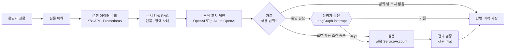

# DataCenterUsedAws

KubeOps Copilot · 데이터 센터 Kubernetes 통합 운영 지원 AI Agent
강원대학교 클라우드캡스톤디자인2 · 앵커사업단 기업문제해결형 과제 · 팀 돈까스단 (SK AX 멘토링)

운영자가 서비스 상태, 응답 지연, 자원 증설 필요성, 장애 원인을 자연어로 물으면 Pod·Deployment 상태, 이벤트, 로그, CPU·메모리, 요청량·오류율·응답 시간, 배포 이력을 모아 분석해요. 운영 문서(런북)와 과거 장애 사례를 함께 검색해서 근거와 권장 조치를 제시해요. 에이전트가 관측값과 현행 런북 원문을 인용해 담당자를 정해요. 로컬 demo/api에서 안전 조건을 충족한 +1 증설과 격리된 실패 리비전 롤백은 자동 실행할 수 있어요. 다른 허용 변경은 승인을 받고, 직접 수정이 필요한 건은 근거와 함께 사람에게 넘겨요.



### 앱에서 운영자까지 이어지는 처리

**조치 → 데모 앱**의 메시지는 로컬 web을 거쳐 api의 echo 경로로 전송됩니다. 일시적인 요청 실패는 앱이 한 번 재시도하고 응답 내용까지 확인합니다. 실패가 계속되면 요청 결과와 클러스터 상태를 에이전트가 확인합니다. **상황 생성기**에서도 같은 요청 경로를 시험할 수 있습니다. 일시적 경고 실험에서는 이 실험의 첫 요청에만 HTTP 503을 주입합니다.

비용 검토가 필요한 증설, 직접 설정 수정, 런북 근거 부족, 변경 후 검증 실패는 **조치 → 티켓·알림**에서 확인합니다. 운영자는 이름을 입력하고 티켓을 접수한 뒤 직접 수행한 내용과 결과를 남깁니다. 승인 요청은 해당 제안에 대해서만 결정할 수 있습니다. 티켓은 로컬 SQLite에 보존되며 macOS에서는 티켓 생성 시 데스크톱 알림도 요청합니다. 시스템 알림 표시는 macOS 알림 권한과 집중 모드에 따릅니다.

**혼동행렬**에서 각 사례를 열면 앱 요청, 런북 판단, 실제 조치, 사람 인계, 실험 환경 정리 순서와 담당자가 표시됩니다. 앱에서 복구가 끝난 사례는 에이전트 탐지 점수의 분모에서 제외됩니다.

## 신청서 항목과 구현 위치

| 신청서 내용 | 구현 |
|---|---|
| Pod·Deployment 상태, 이벤트, 로그, CPU·메모리, 배포 이력 연계 분석 | `kubeops_copilot/k8s_tools.py`, `metrics.py` (근거마다 E번호 부여) |
| 운영 문서와 과거 장애 사례 참고 (RAG) | `knowledge/runbooks`, `knowledge/incidents`, `kubeops_copilot/rag.py` |
| LLM, RAG, LangGraph로 조회 → 검색 → 분석 → 제안 흐름 구성 | `kubeops_copilot/graph.py` |
| 제한 자동 조치와 승인 변경, 허용 범위 밖 요청 인계 | `actions.py`(허용 목록) + `graph.py`(interrupt) + `k8s/rbac/agent-rbac.yaml`(RBAC) |
| 실행 후 오류율·응답 시간·Pod 상태로 결과 검증 | `graph.py`의 `verify` 노드 |
| 웹 화면: 분석 근거, 권장 조치, 실행 전후 상태 | `app/streamlit_app.py` |
| 테스트용 Kubernetes 구성 파일 | `k8s/` (kind 클러스터, 데모 앱, 부하 생성기, Prometheus, 권한) |
| 운영 및 장애 재현 시나리오 | `scenarios/` 기본 스크립트 7종, Streamlit 상황 생성기에서 단일 14종 재현 및 탐지 평가(`eval/single_detection.py`) 지원. [생성기 요구사항](docs/PRD.md) · [로컬 실습 방법](docs/demo-script.md#14가지-단일-상황) |
| 탐지·처리 방식·조치 선택·실제 복구 평가, 권한 범위와 승인 대기 검증 | `eval/single_detection.py`, 기존 7종 비교용 `eval/run_eval.py`, `eval/manual-check.md` |
| 질문·근거·조치 이력과 검증 결과를 운영 사례로 축적 | `audit.py`(SQLite) + 검증된 조치의 초안은 `knowledge/candidates/`에 기록하고 사람이 검토한 뒤 사례로 채택 |
| GPU·추론 비용 분석 확장 구조 | 메트릭 조회가 `metrics.py`에 모여 있어 DCGM exporter 메트릭을 같은 방식으로 추가 가능 (미구현) |

## 폴더 구조

```
app/streamlit_app.py      웹 화면
kubeops_copilot/          에이전트
  graph.py                LangGraph 흐름 (질문 이해 → 수집 → 검색 → 분석 → 가드 → 승인 → 실행 → 검증 → 저장)
  k8s_tools.py            Kubernetes 조회와 근거 정리 (읽기 전용)
  metrics.py              Prometheus 조회
  actions.py              허용 범위 검사와 조치 실행
  rag.py                  런북·장애 사례 검색
  audit.py                이력 저장 (SQLite)
  llm.py, config.py       OpenAI 및 Azure OpenAI 연결, 설정·정책
  cli.py                  터미널용 명령
k8s/                      테스트 클러스터 구성 파일
knowledge/                RAG 문서 (런북, 장애 사례)
scenarios/                장애 재현 스크립트와 기대 결과
eval/                     평가 스크립트
scripts/                  클러스터·Azure 설정 스크립트
```

## 준비물 (macOS 기준)

```bash
brew install colima docker kind kubernetes-cli helm uv azure-cli
```

```bash
colima start --cpu 4 --memory 8
```

## 1. 테스트 클러스터 띄우기

```bash
./scripts/setup-cluster.sh
```

전용 kind 클러스터 `datacenterusedaws`(control-plane 1대, worker 2대), Prometheus, 데모 앱(`demo/api`, `demo/web`), 부하 생성기(`traffic/*`), Copilot 전용 권한을 한 번에 구성해요. 끝나면 `.kube/agent.kubeconfig`가 생기는데, Copilot은 이 파일의 제한된 권한으로 클러스터에 접근해요. 관리자 설정은 `.kube/admin.kubeconfig`에 저장하며, 설치·장애 재현 스크립트가 이 파일과 `kind-datacenterusedaws` 컨텍스트를 사용해요.

에이전트 토큰은 API 서버에 최대 8시간의 유효 기간을 요청해 발급해요. 만료되면 `./scripts/make-agent-kubeconfig.sh`로 다시 발급하고 웹 앱을 재시작하세요. 이 명령은 Kubernetes 접근 자격만 갱신해요.

- web 데모: http://localhost:8080
- Prometheus: http://localhost:9090

8080번과 9090번 포트를 사용하는 기존 실습이 있으면 포트가 비어 있을 때 클러스터를 시작하세요.

## 2. 모델 API 연결

프로젝트 루트의 `.env.example`을 참고해 `.env`에 다음 값을 설정하세요.

```dotenv
OPENAI_API_KEY=
OPENAI_CHAT_MODEL=gpt-4.1-mini
OPENAI_EMBEDDING_MODEL=text-embedding-3-small
```

`OPENAI_API_KEY`를 채우면 채팅과 임베딩에 OpenAI API(`https://api.openai.com/v1`)를 사용해요. 모델 변수 두 개는 위 기본값으로 쓰려면 생략해도 돼요. `.env` 저장 후 웹 프로세스를 재시작하세요. 임베딩 제공자나 모델 설정이 바뀌면 첫 검색에서 문서가 다시 색인돼요.

### Azure OpenAI 사용

`OPENAI_API_KEY`가 비어 있으면 Azure 설정을 사용해요.

이미 만든 리소스를 쓰려면 `.env.example`을 `.env`로 복사하고 `AZURE_OPENAI_ENDPOINT`를 채우세요. API 키를 비워 두면 `az login`한 계정으로 인증해요. 이때 그 계정에 리소스의 "Cognitive Services OpenAI User" 역할이 있어야 해요.

새로 만들 때는 아래 스크립트를 쓰세요.

```bash
./scripts/azure-setup.sh <전역에서 유일한 리소스 이름>
```

팀원에게 권한을 줄 때는 아래 명령을 쓰세요. 팀원이 같은 디렉터리에 게스트로 초대돼 있어야 해요.

```bash
az role assignment create --assignee <팀원 이메일 또는 objectId> --role "Cognitive Services OpenAI User" --scope $(az cognitiveservices account show -n <리소스 이름> -g rg-kubeops-copilot --query id -o tsv)
```

## 3. 실행

웹 화면은 기본값으로 내 컴퓨터의 `127.0.0.1:8501`에서 열립니다. 승인자 이름은 기록용이고 접속자를 인증하는 기능은 없으므로, 포트를 외부 네트워크에 공개하지 마세요.

```bash
uv run streamlit run app/streamlit_app.py
```

터미널:

```bash
uv run kubeops check
```

```bash
uv run kubeops ask "api 응답이 느려진 것 같아. 자원 증설이 필요해?"
```

## 4. 장애 재현

```bash
./scenarios/crashloop/inject.sh
```

```bash
./scenarios/reset.sh
```

| 시나리오 | 주입 내용 | 기대 분류 | 기대 조치 |
|---|---|---|---|
| normal | 변경 없음 | none | none |
| high-load | api 요청을 초당 20건에서 4,000건으로 고정 증가 | high_load | scale |
| crashloop | 존재하지 않는 플래그가 들어간 버전 배포 | crashloop | rollback |
| oom | 시작 시 256MB를 쓰는 버전 배포 (limit 128Mi) | oom | rollback (limit 조정은 수동 안내) |
| probe-fail | readinessProbe 경로를 잘못 바꾼 버전 배포 | probe_failure | rollback |
| service-broken | api Service selector를 잘못된 레이블로 변경 | service_misconfig | manual (Service 수정 안내) |
| bad-deploy | 모든 요청이 0.3~0.7초 느려지는 버전 배포 (Pod·헬스체크는 정상) | bad_deploy | rollback |

## 5. 평가

전체 시나리오와 안전성 점검을 실행해요. 조치 승인부터 결과 검증까지 포함되고, 약 25분 걸려요.

```bash
uv run python eval/run_eval.py --scenarios all --approve 평가봇 --safety
```

결과는 `eval/results/<시각>.md`(표)와 `.json`(원본)으로 저장돼요. 같은 조건에서 여러 번 돌리려면 `--repeat 3`을 붙이세요. 수동 점검과 비교할 때는 `eval/manual-check.md`에 팀원이 직접 진단한 시간과 결과를 적으세요.

평가 결과와 운영 SQLite 기록은 로컬에 저장돼요. 공개본을 처음 실행하면 해당 화면에 평가 기록이 비어 있어요.

## 안전장치

1. **LLM은 명령을 만들지 않아요.** 구조화된 제안(조치 종류, 대상, 복제본 수)만 내고, 실행은 `actions.py`가 정해진 방식으로만 해요.
2. **가드가 허용 범위를 검사해요.** 조치는 재시작·롤백·스케일만, 대상은 `demo/api`와 `demo/web`, 복제본은 1~6개로 제한해요. 운영자가 직접 지시한 조치도 똑같이 검사해요.
3. **승인과 제한 자동 처리를 구분해요.** 로컬 demo/api의 두 자동 절차는 실행 직전에 조건을 재검사해요. 다른 허용 변경은 운영자가 승인할 때까지 기다려요.
4. **RBAC가 한 번 더 막아요.** 전용 ServiceAccount는 `demo` 관측 데이터와 실습 여부를 확인하는 control-plane 노드 한 대를 조회해요. Deployment 패치·스케일은 `demo/api`와 `demo/web`에만 허용하고 Secret 조회는 차단해요.
5. **모든 과정이 기록돼요.** 질문, 근거, 제안, 승인자, 실행, 검증 결과가 `data/kubeops.db`에 남아요.
6. **실습 데이터로 실행하세요.** 모델 호출에는 질문, 선별된 Pod 로그·이벤트, 런북 등의 근거가 설정한 모델 제공자로 전송돼요. 실제 계정 정보나 개인정보가 포함된 클러스터와 문서를 연결하지 마세요.

## 정리와 비용

```bash
./scripts/teardown.sh
```

로컬 클러스터에는 클라우드 요금이 없어요. 모델 API 사용료는 연결한 제공자에 청구돼요. 프로젝트가 끝나고 Azure 리소스가 더 이상 필요 없으면 아래 명령으로 정리할 수 있어요.

```bash
az group delete -n rg-kubeops-copilot
```

## 알려진 한계와 다음 단계

- 조치 대상은 Deployment 하나씩이에요. 여러 서비스에 걸친 연쇄 장애 분석은 아직 없어요.
- 검증은 롤아웃 완료 뒤 고정 시간(기본 60초) 동안의 지표로 판단해요. 트래픽이 적으면 판단 근거가 약해져요.
- 웹 화면의 승인 대기 상태는 서버 메모리에만 있어서, 서버를 재시작하면 대기 중인 승인은 사라져요. 이력은 남아요.
- 12월 MCP 수업 이후: 조회·실행 도구를 MCP 서버로 감싸서 다른 에이전트·클라이언트가 재사용할 수 있게 하기
- GPU 데이터를 받으면: `metrics.py`에 DCGM exporter 메트릭(GPU 사용률, 메모리)을 추가하고 분류에 `gpu_saturation`을 넣기

**단일 14종 탐지 평가**는 웹의 상황 생성기에서 시드와 조건을 확인한 뒤 실행해요. 혼동행렬 탭에서 실측 정답과 모델 판정을 비교하고 오탐·미탐 사례의 근거를 확인할 수 있어요. [실행 방법과 채점 기준](docs/demo-script.md#단일-14종-평가와-혼동행렬)

## 장애 전후 Grafana 대시보드와 수동 Argo CD

기존 Prometheus를 사용하는 [Grafana 대시보드](http://127.0.0.1:3000/d/kubeops-demo-api/demo-api)와 [Argo CD](https://127.0.0.1:8081/applications/argocd/kubeops-demo)는 로컬 포트 포워딩으로 접속한다. Streamlit의 **클러스터 현황 → 상세 모니터링 (Grafana)**에서 실험 시간대별 Grafana 그래프를 확인한다. 배포 상태와 수동 동기화는 Argo CD 원본 화면에서 관리한다. 설치 및 재접속 방법은 [로컬 운영 가이드](docs/demo-script.md#장애-전후-대시보드와-배포-비교)를 따른다.

## 위험 등급과 처리 방식

왼쪽 예시 질문 위에서 **위험 등급과 처리 기준**을 펼치면 공통 정책을 확인할 수 있다. **혼동행렬**에서 독립 HTTP 정답, 모델의 최초 담당·조치 선택, 정책 적용 후 실행, 정리 전 복구 결과를 각각 확인한다. 현재 운영 문서와 보관본의 차이는 [런북 버전 기록](docs/runbook-versions.md)에 정리했다.

## GitHub CI와 로컬 배포

`main` 푸시와 PR마다 GitHub Actions가 Python 3.11에서 `uv.lock`에 고정된 의존성으로 단위 테스트를 실행해요. 같은 검증은 로컬에서도 실행할 수 있어요.

```bash
uv sync --locked --python 3.11
uv run --no-sync python -m unittest discover -s tests -v
```

Argo CD는 이 공개 저장소의 `main`에서 데모 매니페스트를 읽어요. 운영자는 커밋, GitHub Actions 테스트 상태와 Argo CD Diff를 확인한 뒤 직접 **Sync**를 실행해요.
